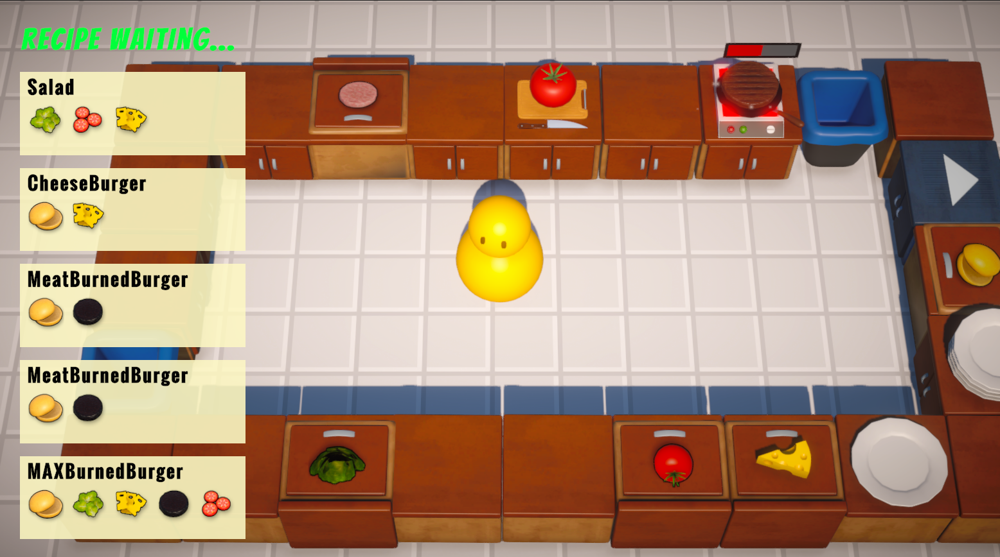

### KitchenFrenzy 项目描述

**KitchenFrenzy** 是一款基于Unity 3D URP管线开发、面向多终端适配的多人实时协作烹饪模拟网络游戏，项目以休闲合作烹饪玩法为核心，依托 Netcode for GameObjects 网络框架搭建标准化客户端-服务端联机体系，完整实现对局联机交互、跨端设备适配、双层数据持久化存储等核心能力，是一套高解耦、可扩展、具备商业化雏形的轻量化3D联机游戏工程方案。

